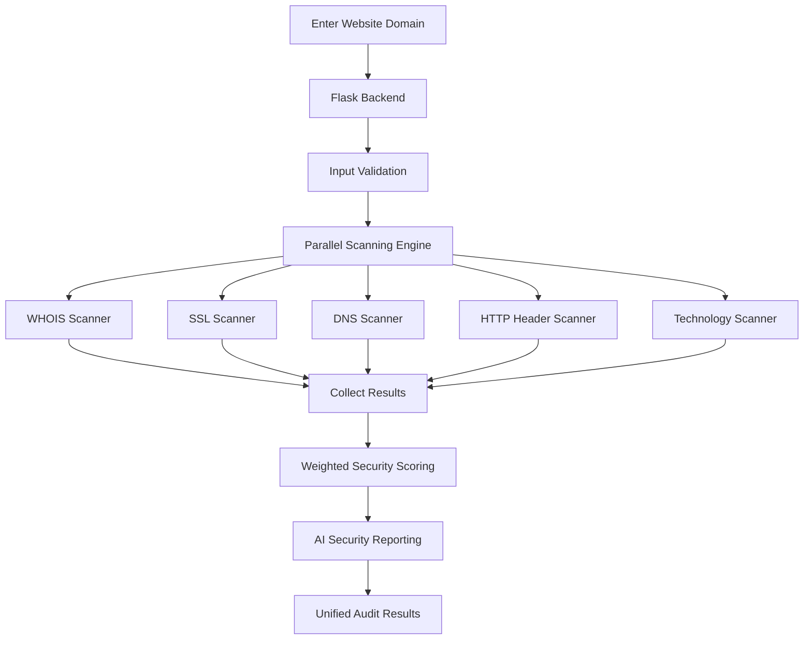

# 🛡️ ConfigAudit | Configuration Auditor

### Web Security Intelligence & Automated Domain Assessment

**ConfigAudit** is a Python Flask-based web security assessment platform designed to analyze publicly accessible website configurations and identify potential security weaknesses.

It combines five independent scanning modules into one unified auditing workflow, examining domain registration information, SSL/TLS certificates, DNS records, HTTP security headers, and website technologies.

The platform generates a weighted security score, provides individual scanner results, and presents prioritized security findings with remediation guidance.

---

## 🌐 Live Demo

<details>
<summary><b>Visit the deployed application</b></summary>

**Live Website:** https://configuration-auditor.onrender.com/

**GitHub Repository:** https://github.com/rathodmilandipsinh-ui/configuration-auditor

</details>

Try entering a domain such as `example.com` to explore the auditing workflow.

---

## ✨ Key Features

| Feature | Description |
|---|---|
| WHOIS & Domain Intelligence | Retrieves registrar, registration date, expiry information and nameservers. |
| SSL/TLS Inspection | Examines certificate issuer, validity, expiration and certificate status. |
| DNS Analysis | Resolves A, AAAA, MX, TXT and NS records. |
| HTTP Security Headers | Evaluates important security headers and identifies missing protections. |
| Technology Fingerprinting | Detects website technologies, frameworks, CMS platforms, servers and hosting technologies. |
| Parallel Scanning | Executes five scanning modules concurrently using Python ThreadPoolExecutor. |
| Weighted Security Score | Generates an overall security score between 0 and 100. |
| AI Security Report | The live interface advertises GPT-4o-powered summaries, prioritized findings and remediation guidance. |

## 🔍 Five Core Scanning Modules

### 1. WHOIS & Domain Intelligence

Collects domain registration information, including:
- Domain registrar
- Creation date
- Expiration date
- Domain expiry countdown
- Nameserver delegation

### 2. SSL/TLS Inspection

Analyzes website SSL/TLS certificates to identify certificate-related issues.

Checks include:
- Certificate issuer
- Certificate subject
- Validity period
- Remaining validity days
- Certificate expiration status

The platform uses four certificate status levels:

`VALID → WARNING → CRITICAL → EXPIRED`

### 3. DNS Record Mapping

Retrieves and examines important DNS records.

Supported record types:
- A
- AAAA
- MX
- TXT
- NS

It also identifies missing SPF and DMARC configurations where applicable.

### 4. HTTP Security Header Audit

Checks important HTTP security headers and evaluates their security configurations.

Headers include:
- Strict-Transport-Security (HSTS)
- Content-Security-Policy (CSP)
- X-Frame-Options
- X-Content-Type-Options
- Referrer-Policy
- Permissions-Policy

### 5. Technology Fingerprinting

Identifies technologies used by a website through its publicly observable characteristics.

Detection coverage includes 50+ signatures across:
- Web servers
- CMS platforms
- JavaScript frameworks
- Analytics platforms
- CDNs
- Hosting technologies

---

## 🧠 Security Scoring & AI Reporting

### Weighted Security Score

ConfigAudit combines findings from its scanning modules to calculate an overall security score.

- Score range: 0–100
- Evaluates multiple website configuration areas.
- Provides individual scanner results.
- Highlights potential security weaknesses.

The score is an assessment indicator, not a guarantee that a website is secure.

### AI-Powered Security Report

The deployed interface advertises GPT-4o-powered reporting capabilities.

The report is designed to provide:

- Executive security summaries.
- Prioritized security findings.
- Potential vulnerability explanations.
- Step-by-step remediation recommendations.

AI-generated recommendations should always be reviewed and validated before implementation.

---

## ⚙️ How It Works



1. **Domain Submission:** The user enters a domain or website URL.
2. **Input Validation:** The backend validates and normalizes the submitted target.
3. **Parallel Execution:** Five independent scanners execute concurrently.
4. **Result Collection:** Individual scanner results are combined.
5. **Security Assessment:** The scoring module calculates the overall security score.
6. **Report Generation:** The deployed interface presents findings and AI-assisted recommendations.
7. **Final Results:** The user receives a unified security assessment.

---

## 🛠️ Technology Stack

| Technology | Purpose |
|---|---|
| Python | Backend programming |
| Flask 3 | Web application framework |
| HTML5 | Frontend structure |
| CSS3 | Interface styling |
| JavaScript | Frontend interactions |
| Bootstrap | UI components |
| ThreadPoolExecutor | Concurrent scanning |
| dnspython | DNS record resolution |
| python-whois | Domain registration lookup |
| Requests | HTTP communication |
| BeautifulSoup4 | HTML parsing and analysis |
| Gunicorn | Production WSGI server |
| GPT-4o | AI reporting advertised by the deployed interface |

---

## 📁 Project Structure

```text
configuration-auditor/
│
├── routes/
│
├── scanners/
│   ├── whois_scanner.py
│   ├── scanner.py
│   ├── dns_scanner.py
│   ├── header_scanner.py
│   ├── tech_scanner.py
│   └── security_score.py
│
├── static/
│   ├── css/
│   ├── js/
│   └── images/
│
├── templates/
│   ├── index.html
│   ├── auditor.html
│   ├── about.html
│   └── error pages
│
├── app.py
├── requirements.txt
├── requirment.txt
├── Procfile
├── .gitignore
└── README.md
```

---

## 💻 Local Installation

Follow these steps to run the project on your local machine.

### Prerequisites

- Python 3.10 or later recommended.
- Git.
- Internet connection.

### 1. Clone the Repository

```bash
git clone https://github.com/rathodmilandipsinh-ui/configuration-auditor.git
```

### 2. Navigate to the Project

```bash
cd configuration-auditor
```

### 3. Create a Virtual Environment

```bash
python -m venv venv
```

Activate it:

**Windows:**

```bash
venv\Scripts\activate
```

**Linux / macOS:**

```bash
source venv/bin/activate
```

### 4. Install Dependencies

```bash
pip install -r requirements.txt
```

### 5. Start the Application

```bash
python app.py
```

### 6. Access the Website

Open your browser:

```text
http://127.0.0.1:5000/
```

**Note:** The local Flask application provides the scanning and scoring functionality. Features advertised by the hosted AI reporting interface may require additional provider configuration and are not guaranteed to work locally with the public repository configuration alone.

---

## 🔌 API Documentation

The application provides individual scanning endpoints and a unified endpoint for performing a complete audit.

| Endpoint | Method | Function |
|---|---|---|
| `/api/whois` | POST | WHOIS information |
| `/api/ssl` | POST | SSL/TLS inspection |
| `/api/dns` | POST | DNS record analysis |
| `/api/headers` | POST | HTTP security header audit |
| `/api/tech` | POST | Technology detection |
| `/api/scan` | POST | Complete security assessment |

### Example: Complete Website Scan

**Endpoint:**

```http
POST /api/scan
Content-Type: application/json
```

**Request Body:**

```json
{
  "target": "example.com"
}
```

**Example Response Structure:**

```json
{
  "success": true,
  "target": "example.com",
  "whois": {},
  "ssl": {},
  "dns": {},
  "headers": {},
  "technology": {},
  "security_score": {}
}
```

Each scanner returns its own results and status information.

The unified endpoint also handles individual scanner failures so that one failed module does not necessarily stop the entire scanning process.

---

## 🚀 Deployment

The application is deployed using **Render**.

**Live URL:**

https://configuration-auditor.onrender.com/

The repository includes a `Procfile` and Gunicorn dependency for production deployment.

Example Gunicorn command:

```bash
gunicorn -w 4 -b 0.0.0.0:5000 app:app
```

---

## 🔐 Responsible Usage

ConfigAudit is intended for educational, defensive, and authorized security assessment.

- Only assess domains you own or have explicit permission to test.
- Scanning focuses on publicly accessible configuration information.
- The tool is not a replacement for a professional penetration test.
- Security scores should not be treated as proof of complete security.
- Always validate findings before making configuration changes.

---

## 🔮 Future Enhancements

Potential improvements include:

- Downloadable PDF security reports.
- Historical security scan comparisons.
- More advanced configuration checks.
- Expanded technology fingerprinting.
- Additional vulnerability detection capabilities.
- Improved reporting and visualization.
- Enhanced remediation recommendations.

---

## 🤝 Contributing

Contributions, suggestions, and improvements are welcome.

1. Fork the repository.
2. Create a new branch.
3. Make your changes.
4. Commit your changes.
5. Submit a Pull Request.

---

## 👨‍💻 Developer

**Milandipsinh Rathod**

Information Technology Student | Python Developer | Cybersecurity Enthusiast

- GitHub: [@rathodmilandipsinh-ui](https://github.com/rathodmilandipsinh-ui)
- Project: [Configuration Auditor](https://github.com/rathodmilandipsinh-ui/configuration-auditor)
- Live Demo: [ConfigAudit](https://configuration-auditor.onrender.com/)

---

## 📄 License

This project is available for educational and learning purposes. Please refer to the repository for licensing and reuse permissions.

---

<p align="center">
  <b>CONFIG AUDIT</b><br>
  Analyze. Assess. Secure.
  <br><br>
  Built with Python & Flask.
</p>
